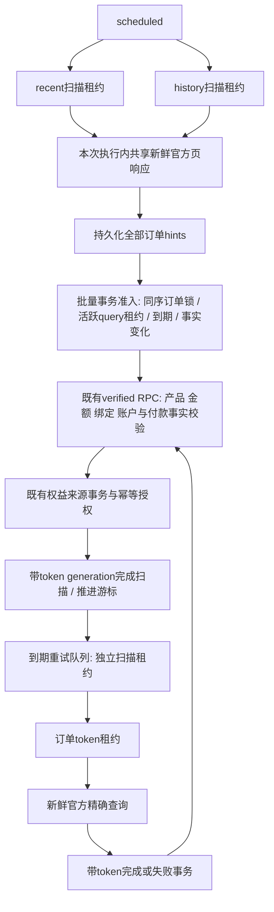

# afdianpay CPU 与重复订单修复审查（2026-10-11）

本任务为 debug-fix；需求与授权以用户本次五阶段指令为准。仅本地实现、合成验证和提交；未部署、未应用生产迁移、未修改 Cron、订单或真实权益。

## ROOT CAUSE

起始提交 `94be7928a7ba6ed4108359d21e577a1e5d905958`，main，工作树干净，唯一工作树；remote 为 ikun-1145/xixi。

已证实的仓库路径：scheduled 同时 recent/history/retry；reconcilePage 先 recordHints、complete（释放扫描租约），然后页面前八笔直接 persistVerified，未经过订单 claim 或 next_retry_at。recent 固定第一页，history 单页时同样第一页。重试队列再次逐笔核验。最新本地 verified RPC 对已有行无条件写事实、attempt_count+1，并另写 status；activated 虽不再次授权，但不断写账本。blocked/null-next_retry unresolved 也被页面绕过保护重复写。

合成模型用实际旧 Worker、4 次 scheduled（30 秒间隔）、12 笔既有订单（4 activated、4 blocked unresolved、4 due unresolved），精确重现 68 次处理、36 unresolved→unresolved、32 activated→activated、同订单最高8次。该复现证明代码路径足以解释样本，不等于证明生产每笔订单的分布。

### 当前生产证据（只读 Cloudflare API）

- `/workers/scripts/afdianpay/schedules`：仅一个 `*/2 * * * *`，created 2026-10-07T10:39:10.692099Z，modified 10:41:53.290811Z。
- 当前部署 `f1ae0c79-b3a2-4594-be1d-957516c7d66d`，100% 版本 `457a3e69-307a-4c4c-a26e-fa1cd3c0e580`，2026-10-07T10:41:50.395837Z。日志对应同一版本。
- service 只有 production 环境，script tag `a319278bea16486a91968265f356270a`；没有证据表明是多个环境或分流历史版本。
- 脚本版本/设置与 account-settings 都为 usage_model=standard；未返回显式 limits。套餐订阅接口权限不足，实际生效 CPU 上限**尚未验证**。不能由10ms推断Free套餐。
- 2026-10-11T02:54Z 附近的一小时查询：119 ok、0 exceededCpu，平均 CPU 22.958ms、最大39ms。24小时聚合：1699 ok、约1180 exceededCpu；失败平均10.021ms、最大18ms；成功最大58ms。聚合包含 sampleInterval>1，24小时数为查询估计值，且滚动窗口不同于用户先前数字。
- 新取8条 invocation 全部 scheduled，cron=`* * * * *`。示例 scheduledTime 秒值 1791687250 / 1791687274，下一分钟 1791687190 / 1791687214；各自不同 requestId。不是同一次 invocation 的两条日志。注意平台日志 scheduledTime 为秒，Worker controller.scheduledTime 单位按运行时契约记录，不能混用。
- 当前日志仍存在 recent/history 对同一订单相邻持久化以及 INTENT_NOT_FOUND 高 attempt_count；报告不保存真实订单号或用户信息。

**Cron 异常来源未证实**：配置变化已有四天，不能用官方最多15分钟传播窗口解释。不同请求ID和两组60秒节奏支持确实存在额外执行来源的推断，但单一配置、单环境、单版本不足以确认隐藏触发器、平台调度状态残留或其它来源。保留证据向 Cloudflare 调查；禁止据此删除触发器。新 reconciliation_started 日志记录 controller 的 cron/scheduled_time，用于与平台事件对照。

**CPU 分类已证实、热点归因有边界**：平台新查询明确 outcome=exceededCpu；仓库重复处理路径及过多 JSON/RPC/日志和纯JS MD5是可消除的工作。没有生产 profiler，不能把CPU消耗精确归给某个函数或声称MD5是唯一根因。脚本内容API返回405，未取得部署源码逐字比较；生产 Supabase MCP本轮不可用，活跃RPC定义、索引和计划尚未核实。本地迁移与日志行为一致并不替代生产目录核验。

参考：[Cloudflare CPU 限制](https://developers.cloudflare.com/workers/platform/limits/)、[Cron 传播](https://developers.cloudflare.com/workers/configuration/cron-triggers/)、[原生 MD5 Web Crypto](https://developers.cloudflare.com/workers/runtime-apis/web-crypto/)。

## CHANGES 与状态流

- Worker 批量提交全页最多50笔正规化事实；数据库只处理最多8笔满足准入的订单，余下新订单已经是durable due hints。订单预算应用于真正处理对象，不固定切前8。
- unchanged retryable unresolved 按 next_retry_at，仍保留原两分钟恢复；稳定 activated/ineligible/blocked 按最后核验时间24小时复核，优先变化和最老核验。不是按ID永久去重。
- 已核验paid变化为退款/撤销/unknown立即优先复核（仍尊重活跃订单租约）；已退款/撤销墓碑不会被旧paid复活。非blocked既有终态的金额/产品/绑定变化进入既有冲突校验；blocked按周期复核，不能每轮重写同一冲突。
- 批量RPC在任何订单锁之前取得固定数据库事务锁，防止不同订单分别绑定同一组用户时发生用户锁反序；最多8笔业务处理，无网络调用持锁。精确查询仍按单订单并发。
- 新 service-only 订单租约表以随机token+2分钟expiry保护精确查询，完成/失败包装RPC同事务检查token。旧token不能覆盖新请求，响应丢失后的重放读权威状态、不再处理。
- 扫描租约延长为3分钟覆盖HTTP超时链路；重试lane完成后20秒冷却、单轮45秒软预算、最多8笔。未启动订单仍在due队列，不会因预算丢失。
- 最近/历史各自扫描租约和游标；同执行同页复用官方Promise，不跨执行缓存付款事实。页处理成功才推进，失败/租约过期保留游标并安全重放。
- 官方MD5签名优先使用Workers原生Web Crypto；仅Node标准运行时NotSupportedError使用原实现。签名内容、验签及金额产品契约保持一致。
- 不改变 verified/activation/Waffo 的函数定义；迁移添加准入包装并保持旧claim签名，只返回额外token。不使用前端状态或缓存激活。

## SAFETY

既有产品/金额/官方证明、绑定冲突、账户删除与封禁、历史消费保护、退款墓碑及权益来源事务原样保留。Afdian退款只记付款事实，不把pro设false，也不自动补发/撤销真实权益。Waffo来源与Afdian来源并存测试使用合成真实SQL事务。旧Worker仍能调用原函数，因此滚动上线期间只有所有执行迁移到新Worker后才可宣称重复准入修复生效；不允许反向回滚Worker而假设新保护仍覆盖旧直写路径。

数据库新迁移仅供审查。必须先读取生产函数定义与ACL验证本地baseline，再批准应用；scan函数补丁遇到锚点漂移会整笔回滚，禁止删除断言硬套生产。数据库异常整批回滚；只有业务输入22023被隔离为持久待核验，不能吞事务失败。

## BEFORE / AFTER

`node tests/afdianpay-load-comparison.mjs`，上述固定4轮12订单模型：

| 指标 | Before | After |
|---|---:|---:|
| 数据库HTTP请求总量 | 112 | 52 |
| RPC HTTP请求 | 108 | 48 |
| 每轮数据库请求 | 37 / 25 / 25 / 25 | 13 / 13 / 13 / 13 |
| 每轮RPC请求 | 36 / 24 / 24 / 24 | 12 / 12 / 12 / 12 |
| 外部订单API总量 | 12 | 4 |
| 每轮外部API | 6 / 2 / 2 / 2 | 1 / 1 / 1 / 1 |
| 实际订单处理 | 68 | 4（必要到期恢复） |
| 单订单最多处理 | 8 | 1 |

独立PGlite真实SQL计数：12笔稳定activated订单、4轮重放，原逐笔verified RPC为48次调用/96次ledger UPDATE，新批量为4次调用/0次ledger UPDATE，processed=0。该计数不包含扫描hints、游标写入或首次付款激活；它是另一种稳定订单场景。

脚本同时输出Node process.cpuUsage，包含Mock、JSON和Response成本，仅本地代理，不把单次值写成改善百分比。**生产修复后CPU时间未测量**，需授权部署后的同窗口观测；没有提高CPU限制、套餐或减少历史功能。

## TESTS 与 PRODUCTION

所有订单为合成数据，未向支付平台制造订单。最终结果：

| 命令 / 检查 | 结果 |
|---|---|
| `AFDIAN_PGLITE_PATH=/tmp/afdian-admission-db/node_modules/@electric-sql/pglite/dist/index.js node --test --test-concurrency=1 tests/*.test.mjs` | 795/795通过，0跳过 |
| 设置同一PGlite路径后 `npm test` 默认并行 | 最新795项：794通过、1失败；此前一次794/794通过；不能把默认并行全套宣称稳定绿色 |
| 起始提交独立git archive副本 `npm test` | 763项：762通过、相同UI时序失败1项 |
| `node --test tests/afdianpay-worker.test.mjs tests/afdianpay-admission-db.test.mjs tests/afdianpay-migration.test.mjs tests/afdianpay-policy.test.mjs tests/afdianpay-uuid-baseline.test.mjs`（同PGlite路径） | 75/75通过，0跳过 |
| `AFDIAN_DOCKER_PG=true node tests/afdianpay-concurrency-lab.mjs` | PostgreSQL16独立连接47项检查通过，临时容器已清理 |
| `node tests/afdianpay-load-comparison.mjs` | 固定Before/After断言通过；模型调用量见上表 |
| `npx --no-install wrangler deploy --dry-run --config workers/afdianpay/wrangler.toml --outdir /tmp/afdianpay-review-bundle` | Wrangler4.103.0打包通过，33.32KiB / gzip9.49KiB，无部署 |
| `node --check workers/afdianpay/worker.js`、实验脚本语法与 `git diff --check` | 通过 |

默认并行失败为 `tests/ai-beta-diagnostics-ui.test.mjs:592` 的跨标签诊断模式等待，实际off而预期summary；原始HEAD完整并行套件已重现，相应单测和全套串行通过。本次未修改、跳过或抑制该测试，保留既有不稳定性证据。

PGlite单连接证明实际SQL事务、ACL、幂等、恢复与来源隔离；并发另由Docker真实多连接验证，包含实际advisory等待、recent/history重叠、scan/query竞争、十个订单领取一个owner、三个lane各六个领取一个owner、反向页顺序及不同订单反向用户绑定。最后一项使用数据库批次锁避免跨订单用户锁死锁。

覆盖付款激活及重复扫描、unresolved未到期/到期恢复、多Cron领取、最近/历史/重试重叠、成功响应丢失重放、超时/429/5xx、退款/撤销/unknown、分页两周期与失败页重试、扫描租约过期重放、Waffo并存/退款、唯一授权、历史尾部最终复核，以及真实SQL写次数和Mock请求量。

主Agent完成最终差异、安全和契约自审；实现Agent与Worker复审提供独立证据。额外独立安全Agent受会话额度限制未完成，未将其计为通过。

**VERDICT：READY FOR REVIEW（本地代码与迁移候选），生产部署尚未授权，Cron来源、有效CPU上限及生产RPC目录仍是待核验项。**

上线前人工操作：核验活跃Supabase目录与迁移baseline；审查并批准新表/RPC迁移，先DB后Worker；单独批准Worker部署；复查Cron异常来源与生效资源限制，不直接改变Cron；部署后核验新付款、退款事实、历史完整周期、due恢复、CPU与DB调用量。观察必须通过正常自动链路，不手改真实权益。
